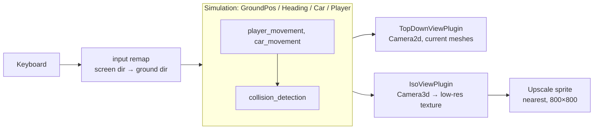

# Isometric Pixel-Art View: Assets & Rendering Brainstorm

Target look: `pics/ideas/idea.jpg` (refined version of `pics/ideas/01_isometric_pixel_art.png`). This doc covers (1) how to make assets in that style and (2) how to drive an isometric view from the existing 2D simulation (`Car`, `Player`, `RoadGeometry`), without rewriting game logic.

## 0. What the reference image actually is

Worth being precise before picking tools, because it changes the answer:

- **Not strict isometric.** The image is a 3/4 _perspective_ view looking down the stroad corridor: lanes converge toward a horizon, cars shrink with distance, sky and hills are visible. True pixel isometric (SimCity 2000) has no vanishing point and no horizon.
- **"Pixel art" is a texture, not a grid.** It's AI-painted: chunky outlines, flat shading, limited palette, but pixels aren't on a consistent grid. `idea.jpg` has mostly legible text (_Walgroins_, _TACO HELL_, _ERRAND AHEAD_), unlike `01` (`WALGPOINS`, `FONKEL`), but the HUD still reads `ERRAND / DEATHS: 3` and small signs are gibberish; final lettering is still hand-drawn.
- **What to keep:** saturated palette, dark outlines, flat 2–3 tone shading, giant asphalt vs. tiny Mats, dense multi-lane traffic (box trucks, lifted pickups), utility poles and wire tangle, pylon signs, strip-mall parking lot, heart + errand/deaths HUD panel, arcade framing (`PRESS START`, `OBJECTIVE: CROSS ROAD` bar along the bottom).
- **What to change:** the _TACO HELL_ pylon copies Taco Bell's bell logo and the _Walgroins_ script copies Walgreens' wordmark. Parody names are the joke; copying the logos adds trademark risk. Redraw both with original marks (e.g. a flaming taco, a different script).

Consequence: a **3D scene rendered at low resolution and upscaled with nearest-neighbor** reproduces this image far more faithfully than hand-drawn isometric tiles, and lets you slide the camera anywhere between true isometric and the reference's 3/4 perspective. That is the recommendation below.

## 1. Rendering approaches

| Approach                              | How it works                                                                                                            | Matches reference                           | Links to 2D sim          | Car rotation                      | Asset cost                                       | Web size                |
| :------------------------------------ | :---------------------------------------------------------------------------------------------------------------------- | :------------------------------------------ | :----------------------- | :-------------------------------- | :----------------------------------------------- | :---------------------- |
| **A. 2D iso sprites**                 | `Camera2d`; project ground `(x,y)` to 2:1 diamond screen coords; sprites sorted by depth                                | Partial (no perspective, no horizon)        | Easy: one projection fn  | 8/16 pre-drawn frames per vehicle | High: every object × every direction drawn       | Smallest (`2d` feature) |
| **B. 3D low-res ("3D pixel art")** ✅ | `Camera3d` (ortho or narrow perspective) renders to a small texture (e.g. 320×320), upscaled ×2.5 with nearest sampling | Best: any angle, horizon, shadows           | Easy: `(x,y) → (x,0,-y)` | Free: just rotate the mesh        | Medium: low-poly models + small palette textures | Larger (`3d` feature)   |
| **C. Hybrid 2.5D**                    | B for world/cars/buildings; Mats and pedestrians as camera-facing pixel sprites (billboards)                            | Best for characters (crisp hand-drawn Mats) | Same as B                | Free for cars                     | Medium                                           | Same as B               |

**Decision: B now, grow into C.** Cars, roads, poles, and buildings as low-poly 3D; Mats as a billboarded pixel sprite once there's a sprite sheet (a capsule mesh until then). Approach A is the fallback if the wasm budget in `plans/3d-plan.md` can't absorb the `3d` feature.

Risk: `plans/3d-plan.md` already records a 29.4 MB baseline against a < 15 MB budget. Adding 3D rendering makes that budget harder. Measure after the spike (§5) before committing; if it blows up, A is the escape hatch, and the sim refactor (§3) is needed by both.

## 2. Making assets

### 2.1 Lock down the style first (one afternoon, saves weeks)

- **Palette:** pick one 32–64 color Lospec palette (e.g. _Resurrect 64_, _Endesga 32_) and quantize _everything_ to it: textures, sprites, UI. This is what makes hand-made, AI-made, and kit assets look like one game.
- **Resolution:** decide the internal render size (e.g. 320×320 → ×2.5 = 800×800, matching the current window) and the scale: current sim is 1 unit = 1 px at 800 px, car = 48×26 units ≈ 4.8 m, so `UNITS_PER_METER = 10`.
- **Style sheet:** a single PNG showing palette, outline rule (dark 1 px outline vs. none), shading (flat 3 tones, light from top-left), and one finished car, pole, and storefront. Every later asset is judged against it.

### 2.2 Asset sources (mix and match)

| Source                                                                                               | Use for                                                                                         | Notes                                                                                                                                                                                                   |
| :--------------------------------------------------------------------------------------------------- | :---------------------------------------------------------------------------------------------- | :------------------------------------------------------------------------------------------------------------------------------------------------------------------------------------------------------ |
| **Kenney kits (CC0)**: _Car Kit_, _City Kit Roads_, _City Kit Commercial_, _City Kit Suburban_ (GLB) | Placeholder → shipping 3D world for approach B                                                  | Already low-poly and flat-colored; recolor via palette texture. Fastest path to a playable scene.                                                                                                       |
| **Blender, hand-modeled low-poly**                                                                   | Hero props: pylon signs, Taco Hell / Walgroins facades, lifted pickup, utility poles with wires | Boxes + bevels, 1 palette texture (UV islands onto palette swatches). Export glTF/GLB.                                                                                                                  |
| **Blender → sprite baking** (for approach A or billboards)                                           | Pre-rendering 3D models into pixel sprite sheets                                                | Ortho camera at 2:1 dimetric (tilt 60° from vertical, 45° yaw), render 8/16 headings at low res, nearest-downscale, palette-quantize. Scriptable with a short `bpy` script.                             |
| **Aseprite (hand pixel art)**                                                                        | Mats sprite sheet, HUD (heart, errand card), sign text, decals (crosswalk, splat, cracks)       | Signs need _real_ readable parody text; never trust AI for lettering.                                                                                                                                   |
| **AI image generation**                                                                              | Concept art, textures (storefront facades, asphalt, grass), pixel-art sprite drafts             | See §2.3 for the cleanup it needs. Tools in this niche: PixelLab, Retro Diffusion (pixel-specific, some support isometric tiles and character rotations) [INFERENCE: check current features/licensing]. |
| **AI image-to-3D** (e.g. Hunyuan3D, TRELLIS on Hugging Face; Meshy, Tripo)                           | Draft meshes for vehicles and buildings from concept art                                        | Output is high-poly and messy: decimate in Blender, re-texture with palette. Good for silhouettes, not finished assets.                                                                                 |

### 2.3 AI pipeline that actually produces usable pixel art

AI output is "pixel-flavored", not pixel art. Required cleanup:

1. Generate at high res with a fixed style prompt + the style sheet as image reference.
2. **Downscale with nearest-neighbor** to the true pixel size (find the AI's implied pixel size, often 4–8 px).
3. **Quantize to the project palette** (Aseprite _Sprite → Color Mode → Indexed_ with the palette loaded, or `pngquant`/ImageMagick `-remap palette.png`).
4. Hand-fix outlines, remove anti-aliasing, redraw any text.
5. For multi-direction sprites, generate one direction and redraw the rest (AI rotations drift in proportions), or bake from 3D instead.

Prompt skeleton that matches the reference:

```
16-bit pixel art, 3/4 top-down view, American suburban stroad, [subject],
thick dark outlines, flat shading, limited palette, bright daylight,
no text, transparent background, game asset
```

### 2.4 Asset list to start (in priority order)

1. Ground: asphalt tile, lane markings (dashed white, double yellow), curb, sidewalk, grass verge, crosswalk decal.
2. Vehicles: sedan, oversized pickup, SUV, box truck (one palette texture, color variants by swapping swatches).
3. Mats: idle + 4/8-dir walk cycle, splat frame.
4. Street furniture: utility pole + wires, streetlight, beg-button pole, pylon sign, traffic signal.
5. Buildings: strip-mall block with swappable facades (_Walgroins_, _Taco Hell_, _Depot Depot_), parking-lot stripes.
6. HUD: heart, errand card (Bevy UI, 9-slice pixel frame).

Put assets under `assets/` (loaded via `AssetServer`; `plans/3d-plan.md` Phase 10 notes adding the Trunk `copy-dir` line when it exists). Commit source files (`.blend`, `.aseprite`) under `art/` so exports can be regenerated.

## 3. Linking the view to the 2D model

### 3.1 Principle: the sim never touches `Transform`

Today `car_movement`, `car_cleanup`, `player_movement`, `collision_detection`, and `restart_game` read/write `Transform.translation.xy` directly, with `Z_*` constants as 2D draw layers. That ties the sim to `Camera2d`. Phase 1 of `masterplan.md` already calls for the fix; the iso view is the reason to do it first:

```rust
/// Simulation position on the ground plane, in world units (1 unit = 0.1 m).
#[derive(Component, Clone, Copy, Default)]
pub struct GroundPos(pub Vec2);

/// Facing angle on the ground plane, radians, 0 = +X (east), CCW positive.
#[derive(Component, Clone, Copy, Default)]
pub struct Heading(pub f32);

/// Optional height above ground (hop, splat arc, parking-garage levels later).
#[derive(Component, Clone, Copy, Default)]
pub struct Elevation(pub f32);
```

All gameplay systems run on `GroundPos`/`Heading`. The view is a plugin that only _reads_ them.



### 3.2 View plugins

- **`TopDownViewPlugin`**: the current visuals. `sync_2d`: `translation = (pos.x, pos.y, layer_z)`, `rotation = Quat::from_rotation_z(heading)`. Keep it forever as the debug view.
- **`IsoViewPlugin`**: spawns visuals as _children or separate entities_ keyed to the sim entity. `sync_3d`: `translation = (pos.x, elevation, -pos.y)`, `rotation = Quat::from_rotation_y(heading)`. Ground `(x, y)` → 3D `(x, 0, -y)` keeps +Y (north) pointing away from the default camera and preserves right-hand traffic.
- Toggle with a key (e.g. `F1`) via a `ViewMode` state, or show top-down as a small minimap viewport over the iso view. Both read the same components, so they can't disagree.
- Spawning: sim systems spawn the sim entity only (`Car`, `GroundPos`, `Heading`). Each view plugin reacts with an `On<Add, Car>` observer (or `Added<Car>` query) to attach its own mesh/scene. Despawn cascades if visuals are children.

### 3.3 Camera

- **Pixel isometric angle:** 45° yaw, **30° pitch** (elevation). For an ortho camera at 45° yaw, a ground axis's on-screen slope equals `sin(pitch)`, so 2:1 lines need `sin(pitch) = 0.5`. The resulting line angle on screen is `atan(0.5)` ≈ 26.57°. Mathematically true isometric (35.26° pitch) gives non-pixel-clean slopes.
- **Reference-image angle:** yaw aligned with the stroad (camera looking down the corridor), elevation ~30–40°, narrow-FOV perspective (15–25°) for the slight convergence. Expose yaw/elevation/FOV as constants and tune by eye.
- **Low-res pipeline:** render `Camera3d` into an `Image` render target (e.g. 320×320, `ImageSampler::nearest()`), display it with a `Camera2d` + `Sprite` scaled to 800×800. Bevy examples to copy from: `2d/pixel_grid_snap` and `3d/render_to_texture` [INFERENCE: verify names against the 0.20 examples directory].
- **Shimmer fix:** snap the 3D camera's position to whole texels in its own view plane, and apply the sub-texel remainder as an offset on the upscaled sprite; this gives smooth scrolling without crawling pixels.
- **Follow:** camera tracks Mats' `GroundPos` with a dead zone; the world can then grow past the 800×800 window (the `WORLD_BOUNDS_*` and spawn/despawn margins become world-space, not window-space).

### 3.4 Input remap

In an iso or rotated view, "up arrow" must mean "up the screen", not "+Y on the ground". Rotate the raw input vector by the camera yaw before it reaches `player_movement`:

```rust
let ground_dir = Vec2::from_angle(-camera_yaw).rotate(screen_dir); // sign depends on yaw convention
```

Keep this in the view plugin (as a resource `ScreenToGround(Mat2)` that `player_movement` consumes) so the top-down view supplies the identity.

### 3.5 Things that change meaning in 3D

- **Draw order:** `Z_ROAD < Z_BLOOD_SPLAT < Z_CAR < Z_PLAYER` becomes irrelevant in 3D (depth buffer). Splat becomes a ground decal at `y = 0.01`. These constants move into `TopDownViewPlugin`.
- **Car footprints:** `Car { width, height }` are axis-aligned and swapped per lane. With `Heading`, store `length`/`width` once and rotate the box; collision can stay AABB while cars only drive axis-aligned, and switch to OBB when turning arrives (Phase 3).
- **Occlusion:** tall trucks and buildings can hide Mats. Options: silhouette Mats through geometry (render Mats a second time with depth test off, flat color), or fade buildings between camera and Mats.
- **Collision is unchanged:** it already runs on 2D circle-vs-AABB; with `GroundPos` it never sees the camera.

## 4. Optional polish (in style of the reference)

- Outline post-process (depth/normal edge detect) for the dark comic outlines.
- Toon ramp material: quantize lighting to 3 bands, then palette-quantize the final low-res frame in a fullscreen pass so lighting can't introduce off-palette colors.
- Sky + distant hills as a 2D pixel-art backdrop behind the 3D layer (only visible at the reference's lower angle).
- Wires between utility poles as catenary line meshes; cheap and very on-theme.

## 5. Implementation Status & Plain-3D Foundation

### 5.1 Completed Plain-3D & Gizmo Debug Foundation

The foundation spike outlined in `plans/3d-plan.md` is fully implemented and validated:

1. **Simulation Decoupling (Phase 1)**: All gameplay mechanics (player movement, traffic progression, curve navigation, stopline deceleration/queuing, rear-end crash detection, and pedestrian collisions) operate on a pure 2D ground plane via `GroundPos(Vec2)` and `Heading(f32)`. Simulation systems never touch Bevy `Transform`.
2. **Plain-3D Main View (`View3dPlugin`)**:
   - Player rendered as a 3D pill/capsule mesh (`Player3d`).
   - Vehicles rendered as 3D box meshes (`Car3d`) with dynamic color materials, braking taillight accents, and crashed deformation materials.
   - Road surface rendered as 3D flat rectangular meshes with `StandardMaterial` (asphalt, borders, dashed centerlines, stoplines).
   - 3D traffic signals with vertical poles, horizontal cantilever arms, signal head housings, and emissive color spheres matching intersection signal state.
   - Perspective camera (`Camera3d`, 55° downward pitch, yaw 0 looking north along corridor) tracking clamped player movement.
   - Entity linking: visual meshes are discrete proxy entities spawned with `linked_spawn`, automatically despawning when the simulation entity is removed.
3. **Gizmo Debug 2D View (`DebugView2dPlugin`)**:
   - `Camera2d` orthographic camera (`TopDownCamera`) drawing road outlines, signal aspect markers, car bounding boxes, player circles, and blood splat X-markers directly from simulation state via Bevy Gizmos.
   - Active only when `ViewMode::TopDown`, skipping all gizmo rendering while in 3D.
4. **View Toggle (`ViewTogglePlugin`)**:
   - Seamless dynamic toggling between `ViewMode::ThreeD` and `ViewMode::TopDown` via the `V` key or the top-left UI button ("2D Debug (V)" / "3D View (V)").
   - Smoothly transfers `IsDefaultUiCamera` and re-targets `UiTargetCamera` so HUD elements remain attached.

### 5.2 Recorded Wasm Sizes & Web Performance

Measurements taken using `trunk build --release --cargo-profile wasm-release`:

| Stage                 | Configuration                                                                       | Uncompressed `.wasm`        | Compressed (gzip) | Status & Notes                             |
| :-------------------- | :---------------------------------------------------------------------------------- | :-------------------------- | :---------------- | :----------------------------------------- |
| **Baseline 2D**       | Bevy default features (2D only)                                                     | 29,431,643 B (~29.4 MB)     | ~7.8 MB           | Initial web baseline                       |
| **Plain-3D Addition** | Bevy default features + `3d`                                                        | 26,343,936 B (~26.3 MB)     | ~7.0 MB           | Includes 3D meshes, materials, lighting    |
| **Feature Trimming**  | `default-features = false`, `["2d", "3d", "ui", "default_platform", "default_app"]` | **25,874,695 B (~24.7 MB)** | **~6.7 MB**       | Omitted unused `bevy_audio`; saved ~470 KB |

- **Browser Validation**: Verified in Chromium on WebGL2. Zero shader compilation errors, zero buffer errors, stable 60 FPS, and depth-tested gizmo contrast against clear color.

### 5.3 Roadmap to Isometric Pixel-Art Style

With the 3D pipeline and 2D debug foundation in place, the path to the target aesthetic from §1 (Approach B/C) consists of:

1. **Render-to-Texture Pipeline**: Render `Camera3d` into a low-resolution offscreen texture (e.g. 320×320 or 400×400) sampled with nearest filtering (`ImageSampler::nearest()`), blitted to the canvas via `Camera2d` + fullscreen quad to achieve authentic pixelation without crawl/shimmer.
2. **Isometric Angle & Deadzone Follow**: Set camera to 45° yaw and 30° elevation (or corridor-aligned narrow perspective), with texel-snapped subpixel smoothing and player deadzone tracking.
3. **Art Asset Integration**: Replace primitive capsule/box meshes with custom low-poly models (Kenney/custom vehicles, strip mall storefronts, utility poles) and billboarded pixel-art sprites for Mats and pedestrians.
